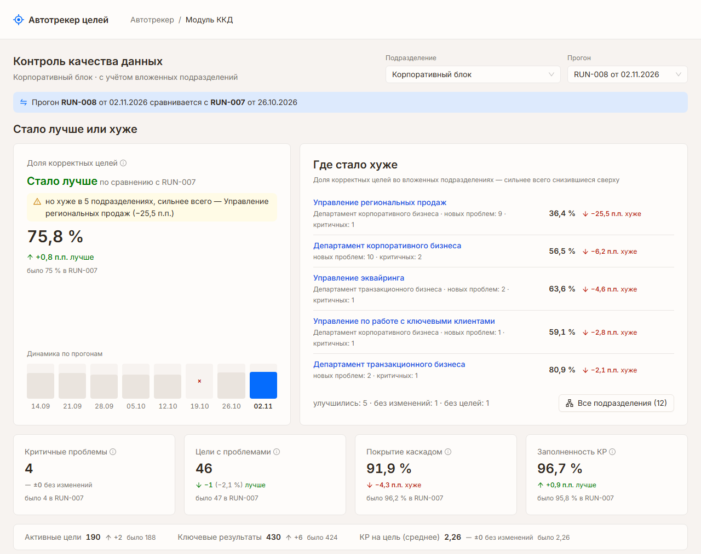
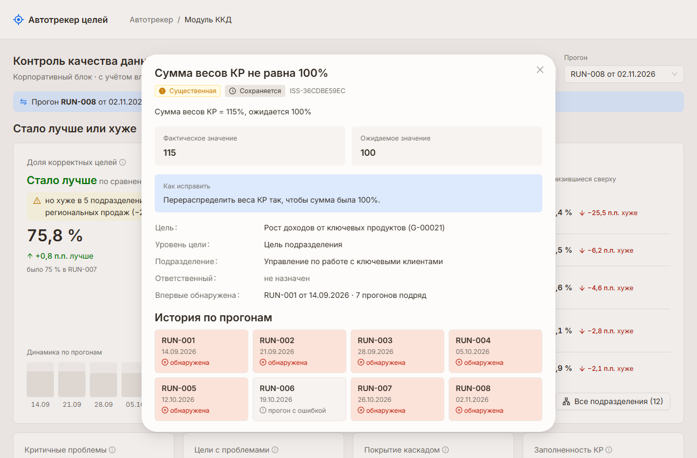

# ККД — страница контроля качества данных по целям

Фронтенд модуля ККД: статистика качества данных по целям и ключевым результатам, найденные
проблемы и дельта с прошлым прогоном. Работает с [mock API](https://gitverse.ru/kkk_s/moc_api_kkd).

**Стек:** React 18, TypeScript, Ant Design 5 (тема из `UI-KIT.md`), TanStack Query, Vite. Тесты — Vitest + Testing Library.



## Запуск

```bash
docker compose up --build
```

Откройте http://localhost:3000. Compose поднимает и фронтенд, и mock API (собирается из его репозитория по
`mock-api/Dockerfile`, API доступен на http://localhost:8000/docs).

Без Docker (нужен Node 20+ и запущенный mock API на `localhost:8000`):

```bash
npm ci && npm run dev
```

Тесты: `npm test`.

## Конфигурация

| Переменная | По умолчанию | Назначение |
|---|---|---|
| `API_URL` | `http://mock-api:8000` в Docker, `http://localhost:8000` в dev | Куда проксируются запросы `/api/*` (nginx в контейнере, Vite в dev). Завершающий слэш допустим |
| `VITE_API_BASE_URL` | пусто | Необязательный прямой адрес API для браузера, в обход прокси (нужен CORS). Подставляется в бандл при сборке: в Docker — аргументом сборки, после изменения нужно `docker compose up --build` |

Адрес API нигде в компонентах не хардкодится: клиент ходит на относительный `/api`, см. `src/api/client.ts`.

## Что на странице

1. **Контекст** — подразделение (дерево из `GET /api/meta`) и прогон (`GET /api/runs`). Явная плашка «RUN-008 сравнивается
   с RUN-007», включая случай, когда между ними пропущен неуспешный прогон. Под названием подразделения сказано, что его
   метрики и проблемы — с учётом вложенных подразделений.
2. **Стало лучше или хуже** — главная карточка «Доля корректных целей» с вердиктом «Стало лучше / хуже» и динамикой
   по прогонам. Цвет дельты — из поля `trend`, а не из знака числа; рядом всегда стрелка и слово.
3. **Где стало хуже** — рядом с итогом: вложенные подразделения, в которых доля корректных целей снизилась сильнее
   всего, и окно «Все подразделения» деревом (`GET /api/kkd/units`, один запрос на прогон). Если итог «лучше», а внутри
   есть ухудшения, под вердиктом оговорка: «но хуже в 5 подразделениях, сильнее всего — Управление региональных продаж
   (−25,5 п.п.)». Ключевые метрики — строкой ниже.
4. **Что исправлять** — счётчики «новые / сохраняются / исправлены» (кликабельны → список с этим фильтром), разбивка
   по важности и правила с нарушениями: сначала критичные, затем самые массовые.
5. **Найденные проблемы** — таблица с фильтрами по правилу, важности, статусу дельты, поиском и серверной пагинацией.
   Кнопка «Выгрузить CSV» скачивает список с текущими фильтрами, все страницы (`GET /api/kkd/issues/export`).
6. **Карточка проблемы** — модальное окно: факт/ожидание, рекомендация, история по прогонам.



Все параметры (подразделение, прогон, фильтры, страница, открытая карточка) хранятся в URL — переключение без
перезагрузки, работает «назад» и ссылкой можно поделиться.

## Граничные состояния

| Ситуация | Поведение |
|---|---|
| `RUN-001` — первый прогон | «нет данных для сравнения» вместо 0; вместо статусов дельты «—», их фильтр отключён и не применяется |
| `RUN-006` — 409 `RUN_FAILED` | Экран с причиной ошибки и кнопкой перехода на последний успешный прогон |
| `TX-NEW` — нет целей | Пустое состояние «нет активных целей», метрики не показываются как нули |
| `TX-SAL` — нет дочерних подразделений | Блока «Где стало хуже» нет, на его месте ключевые метрики |
| Долгий ответ | Скелетоны при первой загрузке; при смене параметров старые данные приглушены с индикатором «Обновляем данные…» |
| Ошибка сети | Сообщение с кнопкой «Повторить» у того блока, который не загрузился; 4xx не ретраятся автоматически |
| Пустой результат фильтра | «По выбранным фильтрам проблем нет» + сброс фильтров |
| Старая или ручная ссылка | Страница за концом списка заменяется последней; неизвестные коды фильтров и размер страницы отбрасываются; у неизвестного подразделения — кнопка перехода на `B2B` |
| Нет ни одного успешного прогона | Сообщение об этом с кнопкой «Проверить ещё раз», а не бесконечная загрузка |

## Структура

```
src/
  api/          клиент fetch, типы контракта, хуки запросов (единые ключи кэша → без дублей запросов)
  app/          тема antd, провайдеры, шапка
  features/kkd/ страница ККД, состояние в URL, компоненты секций
  shared/       форматирование, индикатор дельты, теги важности и статуса, справочники из /api/meta,
                кнопка в виде ссылки, заголовок модалки, текст для экранного диктора
  test/         настройка тестов и сохранённые ответы mock API
mock-api/       Dockerfile, которым compose собирает mock API из его репозитория (коммит зафиксирован)
nginx/          раздача сборки, сжатие и прокси /api в контейнере
research/       исследование данных mock API, на котором основаны решения
specs/          спецификация
```

## ИИ-ассистент

Решение написано с ИИ-ассистентом (Claude Code). Спецификация, по которой шла работа, — в [specs/](specs/):
[requirements.md](specs/requirements.md) и [design.md](specs/design.md). Основание решений — исследование в
[research/](research/).
